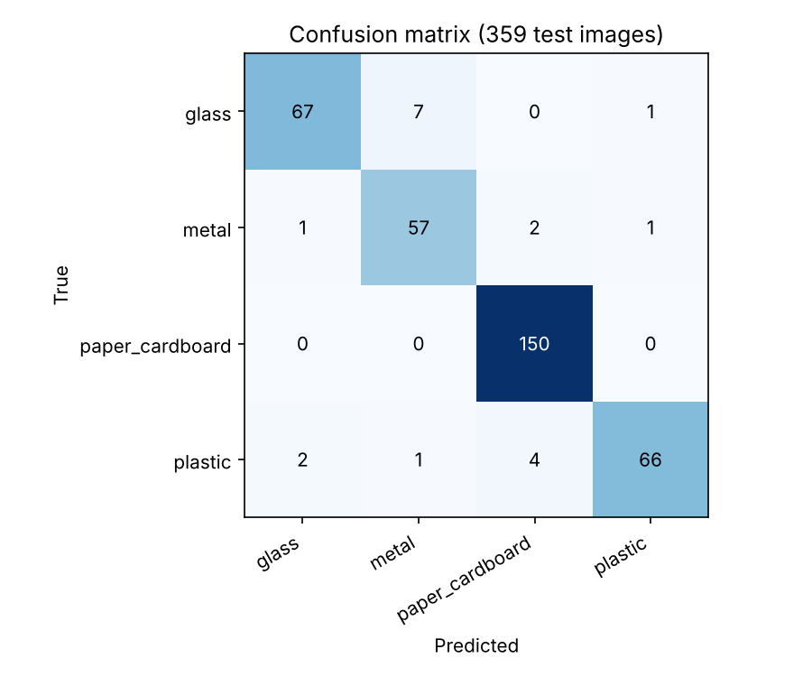

# Kuppai-to-Kaasu: Offline Waste-Segregation and Scrap-Value Assistant

**Arm Bharat AI-SoC Challenge 2026 · Phase 1 · PS2: Smart recycling and waste-segregation assistant using multimodal interfaces**

Point your phone at a waste item. The app identifies the material, shows an approximate scrap price in Rs/kg, and a Llama 3.2 1B model running on the phone with ExecuTorch explains how to prepare the item and whether it is worth selling. It runs on an Arm-based Android phone with no internet.

- Demo video: _paste public link_
- Final report: `docs/Kuppai-to-Kaasu_Final_Report.docx`

---

## 1. How it works

```
Photo (camera or gallery) + optional typed question
        │
        ▼
WasteClassifier: MobileNetV2 (TFLite, float16, 4.52 MB) → class + confidence
        │   (below 0.60 confidence: "not sure", Llama is not called)
        ▼
ScrapAdvisor: scrap_rates.json + prompt_template.txt → prompt with class, rates, question
        │
        ▼
Llama 3.2 1B Instruct (.pte, 784 MB) on ExecuTorch (XNNPACK, Arm CPU)
        │
        ▼
Answer streamed to the chat screen (with tokens/s and time)
```

The vision pipeline and the language-model pipeline are separate modules.

## 2. What is implemented in Phase 1

- Camera or gallery photo input, plus typed questions (the multimodal interface)
- Four-class classifier: glass, metal, paper_cardboard, plastic
- Approximate scrap-value table (Rs/kg) and a confidence threshold of 0.60
- On-device Llama 3.2 1B Instruct through ExecuTorch (required for PS2)
- Tested in airplane mode on an Arm phone

**Not implemented yet** (planned for Phase 2, see section 7): voice input and spoken answers, e-waste / organic / hazardous classes, Tamil, Hindi and other local languages, and a custom dataset.

## 3. Results

Measured on a realme P4 Pro 5G (RMX5116, arm64-v8a, 8 GB RAM), airplane mode on.

**Classifier (held-out test set, 359 images):** 94.71% accuracy (Keras and TFLite identical), model size 4.52 MB.

| Class | Precision | Recall | F1-score | Test images |
|---|---|---|---|---|
| glass | 0.96 | 0.89 | 0.92 | 75 |
| metal | 0.88 | 0.93 | 0.90 | 61 |
| paper_cardboard | 0.96 | 1.00 | 0.98 | 150 |
| plastic | 0.97 | 0.90 | 0.94 | 73 |
| macro average | 0.94 | 0.93 | 0.94 | 359 |

**Confusion matrix** (rows = true class, columns = predicted class):

| True \ Predicted | glass | metal | paper_cardboard | plastic |
|---|---|---|---|---|
| glass | 67 | 7 | 0 | 1 |
| metal | 1 | 57 | 2 | 1 |
| paper_cardboard | 0 | 0 | 150 | 0 |
| plastic | 2 | 1 | 4 | 66 |



The biggest confusion is glass predicted as metal (7 of 75). paper_cardboard is the largest class (42% of the test set), so the macro-average F1 of 0.94 is a fairer summary than overall accuracy.

**On-device test with real photos (one item per class):**

| Item | Predicted (confidence) | Classify time | Llama speed | Generation time |
|---|---|---|---|---|
| Clear plastic container lid | Plastic (67%) | 220 ms | 11.71 tok/s | 9.7 s |
| Steel bowl / lid | Metal (68%) | 186 ms | 12.25 tok/s | 10.1 s |
| Cardboard box | Paper & cardboard (94%) | 334 ms | 14.42 tok/s | 7.7 s |
| Glass jar | Glass (97%) | 140 ms | 14.78 tok/s | 5.4 s |

Model load time on the phone was about 0.5 s. All four photos were classified correctly, but four photos is a small sample and is not a measure of real-world accuracy. Screenshots are in `docs/screenshots/`.

## 4. Limitations

- Only four classes. TrashNet images have plain backgrounds, so accuracy on cluttered real photos is likely lower than 94.71%.
- Scrap rates are static and approximate (from public price listings), not live prices.
- The metal range shows Rs 18 to 850 because the copper sub-type (850) is included in the top-level maximum. Fix: set the metal `"max"` to 55 in `scrap_rates.json` and keep copper as a sub-type.
- The 1B model can give inconsistent advice (for example, calling a price "lower than Rs 15" when Rs 15 is inside the given range, or mentioning items not in the photo).
- English text only; no voice yet.

## 5. Repository contents

```
.
├── README.md
├── SETUP_LOG.md                  # full build log, problems and fixes
├── android-app/                  # LlamaDemo-based Android project (Kotlin, Jetpack Compose) with the scan feature
│   └── app/src/main/assets/      # waste_classifier.tflite, labels.txt, scrap_rates.json, prompt_template.txt
├── training/
│   └── train_waste_classifier_kaggle.ipynb
└── docs/
    ├── Kuppai-to-Kaasu_Final_Report.docx
    ├── confusion_matrix.png
    └── screenshots/
```

The Llama `.pte` (784 MB), `tokenizer.model` and `.pth` files are **not** stored in the repository (see `.gitignore`).

## 6. Reproduce

Requirements: Windows with WSL2 Ubuntu 22.04 (or a Linux machine), Android Studio, an arm64 Android phone, Hugging Face access to Llama 3.2 (licence accepted). Internet is needed only on the development machine.

1. **Export the LLM** (Python 3.11 to 3.15, ExecuTorch 1.6.0):
   ```bash
   python3.12 -m venv ~/venv && source ~/venv/bin/activate
   pip install executorch                         # 1.6.0
   git clone https://github.com/pytorch/executorch.git ~/executorch
   cd ~/executorch && git checkout v1.6.0 && git submodule update --init --recursive
   bash examples/models/llama/install_requirements.sh
   hf auth login
   hf download meta-llama/Llama-3.2-1B-Instruct --include "original/*" --local-dir ~/.llama/checkpoints/Llama3.2-1B-Instruct
   export CK=$HOME/.llama/checkpoints/Llama3.2-1B-Instruct/original
   python3 -m examples.models.llama.export_llama --checkpoint $CK/consolidated.00.pth --params $CK/params.json \
     -kv --use_sdpa_with_kv_cache -X --xnnpack-extended-ops -qmode 8da4w --group_size 64 -d fp32 \
     --metadata '{"get_bos_id":128000, "get_eos_ids":[128009, 128001, 128006, 128007]}' \
     --embedding-quantize 4,32 --output_name="llama3_1B_kv_sdpa_xnn_qe_4_64_1024_embedding_4bit.pte" \
     --max_seq_length 1024 --max_context_length 1024
   ```
2. **Push the model to the phone** (USB debugging on):
   ```bash
   adb shell mkdir -p /data/local/tmp/llama
   adb push llama3_1B_kv_sdpa_xnn_qe_4_64_1024_embedding_4bit.pte /data/local/tmp/llama/
   adb push tokenizer.model /data/local/tmp/llama/
   ```
3. **Classifier:** run `training/train_waste_classifier_kaggle.ipynb` (Kaggle, GPU T4, internet on) or use the provided `waste_classifier.tflite` and `labels.txt` (order: glass, metal, paper_cardboard, plastic). Input is 1x256x256x3 float32, raw 0-255 pixels.
4. **Build the app:** open `android-app/` in Android Studio (JVM 21), sync, and run on the phone. The app uses the prebuilt `org.pytorch:executorch-android` library.
5. In the app settings choose the `.pte` and `tokenizer.model` from `/data/local/tmp/llama`, model type Llama 3, backend XNNPACK. Turn on airplane mode, tap the camera icon, and scan an item.

## 7. Future work and improvement plan

Everything in this section is **planned for Phase 2 and is not implemented in the Phase 1 submission.**

### 7.1 Better data: our own dataset with more classes

The Phase 1 classifier is limited by its data: TrashNet has only four usable classes and plain backgrounds. In Phase 2 we plan to build our own dataset.

- **New classes:** e-waste (batteries, chargers, cables, small electronics), organic / food waste, hazardous items (batteries, bulbs, medicine strips, aerosol cans), textiles, multi-layer packaging, and an **"unknown / other"** class so the app can say it does not know instead of guessing.
- **Photos taken by us** on phones, in real conditions: cluttered backgrounds, different lighting, wet or dirty items, crushed items, and items common in India (PET bottles, steel utensils, chips packets, cartons, cloth).
- **Targets:** start with about 100 or more photos per class, then grow the set. Keep a separate real-photo test set that is never used for training, and report accuracy on it next to the TrashNet result.
- **Methods:** stronger augmentation, class balancing, and checking the confusion matrix after each round (today the main confusion is glass predicted as metal).

### 7.2 Local languages

- **Order:** Tamil first, then Hindi, then other Indian languages (for example Telugu, Kannada, Malayalam, Bengali, Marathi).
- **Offline speech:** Android offline speech recognition and text-to-speech language packs for voice input and spoken answers, so the app stays fully offline.
- **Answers in the user's language:** Llama 3.2 1B does not officially support Tamil, so we plan to compare three options and measure them: curated translated templates and a term table for items and prices; a small multilingual model; and fine-tuning a small model. Native speakers will review the output before we claim support.
- **Testing:** with Tamil and Hindi speakers, including users who are not comfortable reading English.

### 7.3 Multimodal interface

- Offline voice input and spoken output (Phase 1 supports photo and typed text only).
- Live camera preview instead of taking a photo first, and multi-item detection so one photo with several items gives several answers.

### 7.4 Better and more reliable advice

- **Ground the advice** in our own data: put the exact rate ranges and short disposal rules in the prompt, and compute statements like "worth selling or not" in code instead of letting the 1B model decide (in Phase 1 the model sometimes contradicted the rate table).
- **Local rules:** small offline packs of municipal segregation rules and collection information per city, searched on the device and given to the model.
- **Safer outputs:** a review of the advice for hazardous items, and a fixed warning text for batteries, glass and chemicals.
- **Quality checks:** a fixed set of test questions and photos to score the answers after every prompt change.

### 7.5 Better scrap prices

- Fix the known metal range display (copper maximum included in the metal range).
- Regional rate packs that can be updated offline, and a way for users or dealers to enter local prices.
- Validate the table with local scrap dealers.
- A directory of nearby buyers. Any optional online update would be separate from the offline mode, and the offline path would keep working without it.

### 7.6 Performance on Arm

- Benchmark against an unoptimised baseline (the Phase 1 report makes no speed-up claim).
- Measure per-app memory, power and temperature, and repeat runs for confidence intervals.
- Compare model sizes and settings (1B and 3B, other quantisation, context length) and try Arm-optimised kernels where the device supports them.
- Run the same pipeline on other allowed PS2 platforms, for example Raspberry Pi 5 with or without an AI HAT+, and compare.

### 7.7 Product and engineering

- A household "segregation score" with history, so people see their own progress and income from scrap.
- Accessibility options: larger text, and voice-only use.
- Unit tests for the classifier and prompt builder, a continuous build, and a signed release APK.
- A user study with households and scrap dealers.

### 7.8 Suggested schedule (Phase 2 runs to 5 February 2027 for shortlisted teams)

| Period | Focus |
|---|---|
| Month 1 | Collect and label the custom dataset, add the new classes and the "unknown" class, retrain, and re-measure |
| Month 2 | Offline voice, Tamil and Hindi, prompt grounding and rate-table fixes |
| Final weeks | Benchmarks against a baseline, user testing, report and demo |

## 8. Team

**Team name:** _add team name_
**Institution / organisation:** _add institution_

| Name | Role |
|---|---|
| Barath Kumar M | Team leader |
| Banu Shree M | Team member |
| Pragathi K | Team member |

**Contact:** Barath Kumar M · +91 79048 11240 · barathkumar.9790@gmail.com

## 9. Licence and acknowledgements

Code: _choose a licence (e.g. MIT)_. The app is based on Meta's ExecuTorch Llama demo (`meta-pytorch/executorch-examples`; see its licence). Llama models are subject to the Meta Llama Community Licence. Classifier trained on TrashNet.
